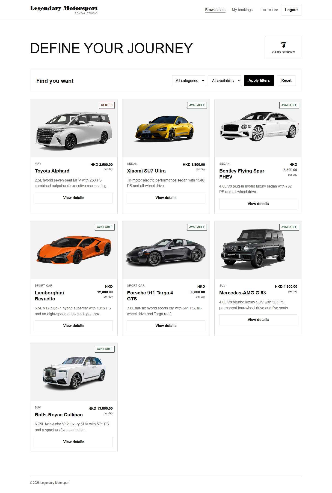
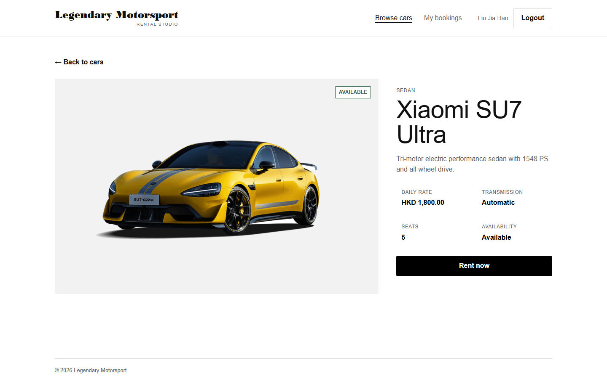
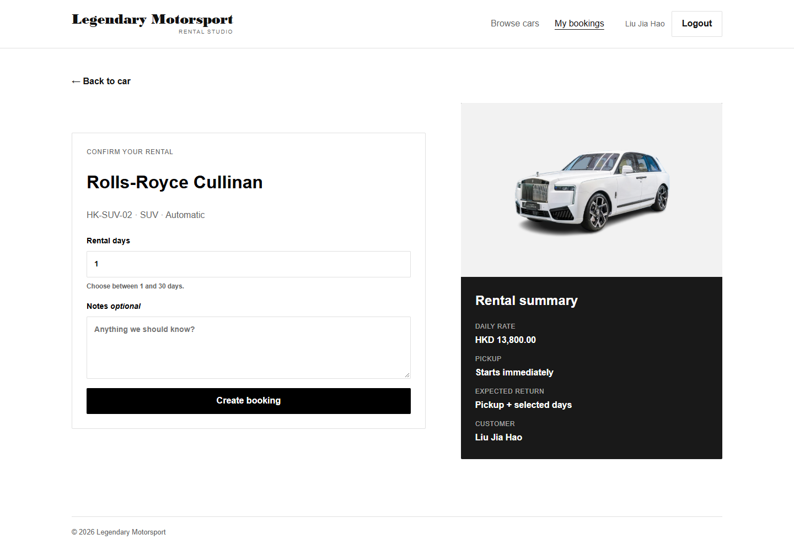
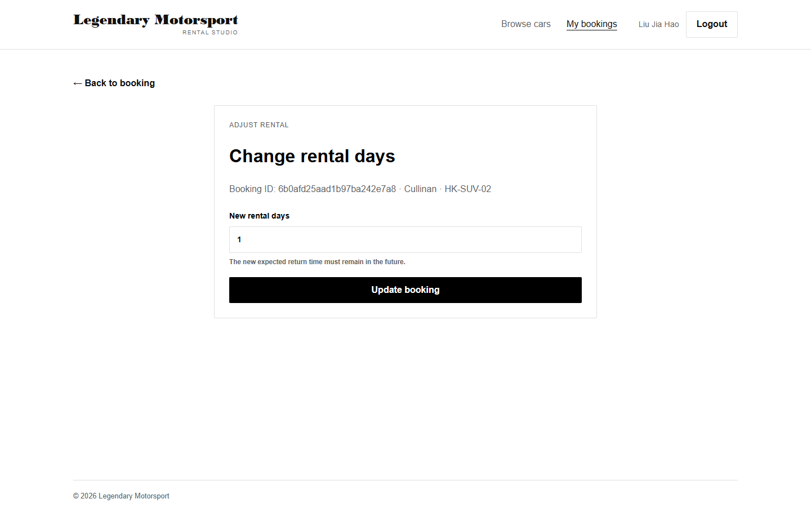
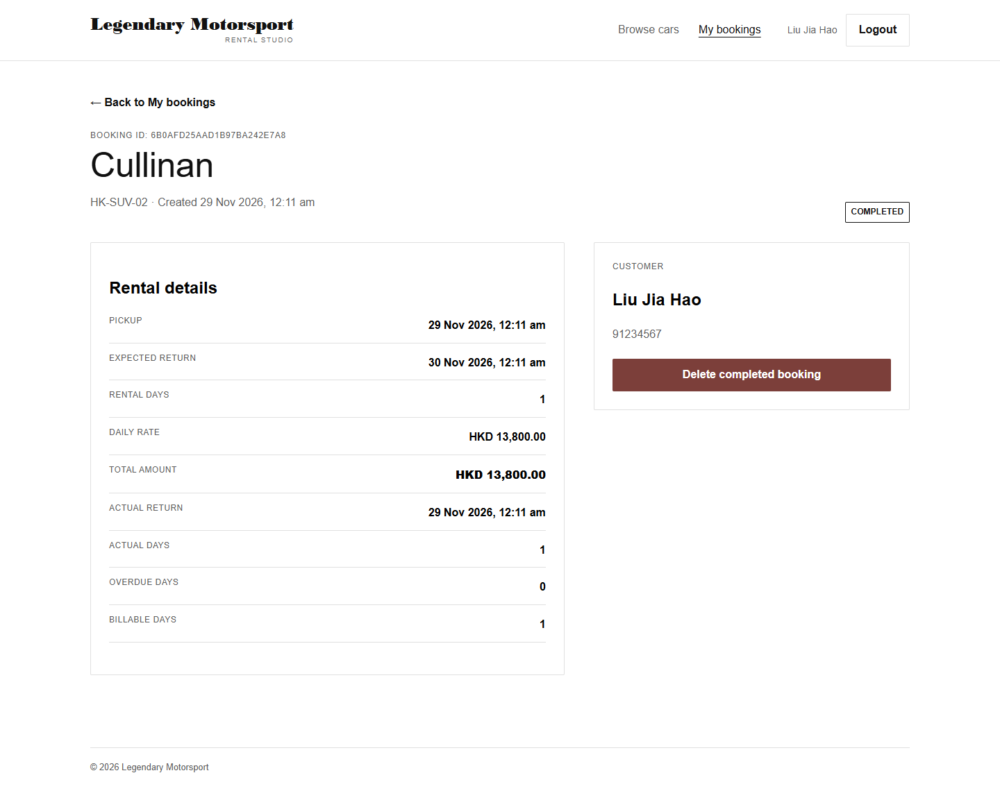
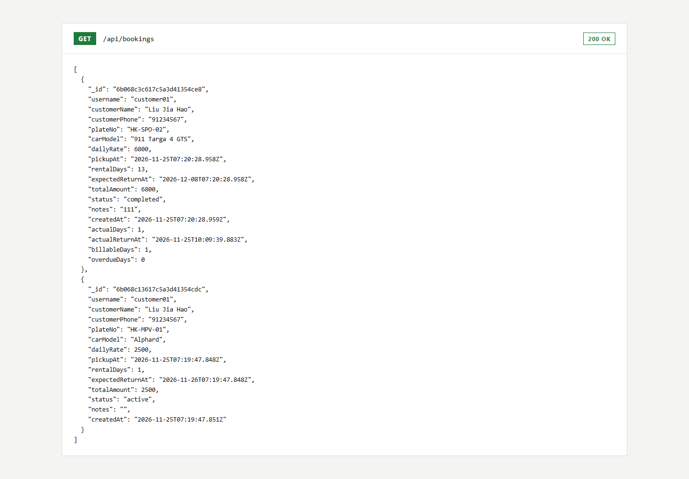

# Legendary Motorsport Car Rental System

Legendary Motorsport is a customer-facing car rental web application built for COMP 3810SEF Group 36. Customers can sign in, browse and filter vehicles, create a rental order, change an active rental period, return a vehicle, and remove completed booking records.

## 1 Project Information

### 1.1 Basic Information

| Item | Details |
|---|---|
| Project name | Legendary Motorsport Car Rental System |
| Project type | Customer car rental web application |
| Purpose | Provide an end-to-end workflow for renting a vehicle, returning it, and calculating the rental charge |
| Target users | Customers who need to rent a vehicle online |
| Local access address | <http://localhost:8099> |
| Repository | <https://github.com/123dvfj123/Comp3810sef_group36> |
| Completion date | 28 November 2026 |

### 1.2 Project Overview

Legendary Motorsport is a customer-facing car rental web application. After signing in, customers can browse and filter vehicles, view vehicle details, create a rental order for 1 to 30 days, change the rental period, return the vehicle, and delete completed bookings. The system uses Node.js, Express, EJS, Mongoose, and MongoDB. Vehicle records are stored in an externally managed database.

### 1.3 Project Scope

The application includes:

- Fixed-account login, Logout, and session-based page protection
- Vehicle list, category filter, availability filter, and vehicle details
- Immediate rental creation with a 1 to 30 day duration and calculated total amount
- Rental-period updates, Return now, completion, and deletion of completed booking history
- Four RESTful CRUD endpoints for rental bookings

The application does not include registration, online payment, deposits, licence-document upload, a staff dashboard, future-date reservations, or AI features.

## 2 Group Information

### 2.1 Course and Repository

| Item | Details |
|---|---|
| Course | COMP 3810SEF |
| Group | Group 36 |
| Repository | <https://github.com/123dvfj123/Comp3810sef_group36> |

### 2.2 Members and Responsibilities

| Member | Student ID | Responsibility |
|---|---|---|
| Yuan Chong Jun | 13705584 | Team leader, frontend design, Git integration, README, and ZIP packaging |
| Huang Wei Jia | 13686319 | Database and API development |
| Tan Yuan Ting | 13374348 | Feature integration |
| Liu Jia Hao | 13662451 | Testing and documentation |
| Hu Qing Kai | 13661454 | Backend development, REST API, CURL testing, quality assurance, presentation materials, and presenting |

## 3 Project File Introduction

### 3.1 Final Project Structure

```text
comp3810sef_group36/
|-- config/
|-- controllers/
|-- docs/
|   `-- screenshots/
|-- middleware/
|-- models/
|-- public/
|-- routes/
|-- views/
|-- .gitignore
|-- curl-commands.txt
|-- package.json
|-- package-lock.json
|-- server.js
`-- README.md
```

### 3.2 Essential Files and Directories

| File or directory | Purpose |
|---|---|
| `server.js` | Express application entry point, middleware, static assets, route mounting, and error handling |
| `package.json` | Dependency list and the `npm start` command |
| `public/` | CSS, login background, vehicle images, and the image fallback |
| `views/` | EJS pages and shared partials |
| `models/` | `Car`, `RentalOrder`, and rental-rule definitions |
| `controllers/` | Web page and REST API request handlers |
| `routes/` | Web and API route definitions |
| `middleware/` | Authentication guard, asynchronous wrapper, and HTTP error helper |
| `config/` | MongoDB connection helper and fixed customer accounts |
| `docs/screenshots/` | Screenshots of the completed workflow |
| `curl-commands.txt` | CURL examples for the four booking API operations |

## 4 Operation Guide

### 4.1 Installation and Startup

1. Install Node.js 20 or later.
2. Run `npm install` to install the dependencies.
3. Run `npm start` to start the server.
4. Open <http://localhost:8099/login>.

The MongoDB connection string is already set in `config/db.js`, so the project can run directly after cloning. The external database must already contain the `cars` collection and its vehicle records. To use a different database, change `MONGODB_URI` in that file.

```bash
npm install
npm start
```

### 4.2 Login and Logout

Valid accounts:

| Username | Password | Customer |
|---|---|---|
| `customer01` | `123456` | Liu Jia Hao |
| `customer02` | `123456` | Huang Wei Jia |

To sign in, open the login page, enter a valid username and password, and select **Enter**. After successful login, the vehicle list opens. Select **Logout** in the top navigation to clear the session and return to the login page.

### 4.3 Web CRUD Operations

| Operation | Page or action | Result |
|---|---|---|
| Create | Open `/cars/:plateNo`, select **Rent now**, enter 1 to 30 rental days, and select **Create booking** | A new active rental order is created |
| Read | Open `/cars`, `/bookings`, or `/bookings/:id` | The vehicle list, booking list, or booking details are displayed |
| Update | On an active non-overdue booking, select **Change rental days**, enter a new duration, and select **Update booking** | The rental period, expected return time, and amount are recalculated |
| Update | On an active booking, select **Return now** | The booking is completed and the vehicle becomes available |
| Delete | Open a completed booking and select **Delete completed booking** | The completed booking is removed |

### 4.4 RESTful CRUD API

The REST API does not use session authentication. Access control should be added before exposing it publicly.

| Method | URI | Success status | Purpose |
|---|---|---:|---|
| GET | `/api/bookings` | 200 | Read all booking records |
| POST | `/api/bookings` | 201 | Create a booking |
| PUT | `/api/bookings/:id` | 200 | Change the rental period of an active, non-overdue booking |
| DELETE | `/api/bookings/:id` | 200 | Delete a completed booking |

POST request body:

```json
{
  "username": "customer01",
  "customerName": "Liu Jia Hao",
  "customerPhone": "91234567",
  "plateNo": "REPLACE-WITH-PLATE",
  "rentalDays": 3,
  "notes": "API request"
}
```

PUT request body:

```json
{
  "rentalDays": 2
}
```

Error response:

```json
{
  "error": {
    "code": "INVALID_INPUT",
    "message": "Detailed error message"
  }
}
```

#### CURL Examples

Set the base URL:

```bash
BASE_URL="http://localhost:8099"
```

Read bookings:

```bash
curl -i "$BASE_URL/api/bookings"
```

Create a booking:

```bash
curl -i -X POST "$BASE_URL/api/bookings" \
  -H "Content-Type: application/json" \
  -d '{
    "username": "customer01",
    "customerName": "Liu Jia Hao",
    "customerPhone": "91234567",
    "plateNo": "REPLACE-WITH-PLATE",
    "rentalDays": 3,
    "notes": "API request"
  }'
```

Change the rental period:

```bash
curl -i -X PUT "$BASE_URL/api/bookings/REPLACE-WITH-ACTIVE-BOOKING-ID" \
  -H "Content-Type: application/json" \
  -d '{"rentalDays": 2}'
```

Delete a completed booking:

```bash
curl -i -X DELETE "$BASE_URL/api/bookings/REPLACE-WITH-COMPLETED-BOOKING-ID"
```

## 5 System Architecture and Technology Stack

The request flow is:

```text
Browser and EJS
  -> Express routes
  -> Controllers
  -> Mongoose models and rental rules
  -> External MongoDB
  -> EJS page or JSON response
```

| Layer | Technology |
|---|---|
| Runtime | Node.js 20 or later |
| Web framework | Express 5 |
| View engine | EJS |
| Data access | Mongoose 8 |
| Database | MongoDB Atlas |
| Session | cookie-session |

The MongoDB URI is configured in `config/db.js` and points to the external course database. The session secret should be replaced before public deployment, and the REST API should be protected before it is exposed outside the course environment.

## 6 Data Model and Business Rules

### 6.1 Car

Each vehicle stores a unique `plateNo`, brand, model, category, transmission type, seat count, daily rate, description, and local image path.

### 6.2 RentalOrder

Each booking stores customer and vehicle snapshots, pickup time, rental days, daily rate, total amount, expected return time, actual return details, status, and optional notes. Rental orders use the statuses `active` and `completed`; overdue is calculated for display.

### 6.3 Business Rules

- A rental starts immediately after the order is created.
- The rental period must be an integer from 1 to 30 days.
- The expected return time equals the pickup time plus the rental period in 24-hour days.
- The active rental amount equals rental days multiplied by the daily rate.
- A return of less than one full day is billed as one day.
- Each overdue day adds one additional daily charge.
- Only an active, non-overdue booking can have its rental period changed.
- A completed booking cannot change its duration or amount.
- Only a completed booking can be deleted.

## 7 Testing and Screenshots

The final interface and API were manually verified. The screenshots below cover the required customer workflow and the successful REST API response.

### 7.1 Login Page


### 7.2 Vehicle List and Filtering



### 7.3 Vehicle Details



### 7.4 Create Booking



### 7.5 Change Rental Period



### 7.6 Completed Booking



### 7.7 REST API Response


